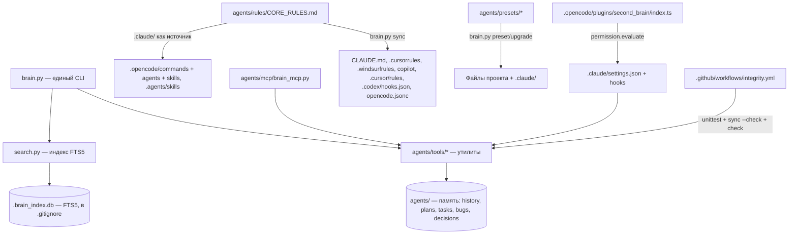

# 🗺️ Карта кодовой базы и граф зависимостей (CODEBASE_MAP.md)

**Проект:** Second Brain Template  
**Последнее обновление:** 2026-10-28  

Этот документ помогает любому входящему агенту за 30 секунд понять файловую структуру проекта, назначение каждого модуля и связи между ними.

---

## 🏗️ Архитектурный граф модулей (Component Graph)



---

## 📁 Структура каталогов и файлов проекта

```
Second Brain Template/
├── brain.py                        # ⚡ Переадресатор на agents/tools/brain.py (удобный вызов из корня)
├── agents/                         # 🧠 «Второй Мозг» проекта (долговременная память)
│   ├── STATUS.md                   # Дашборд состояния
│   ├── AGENT_GUIDE.md              # Главный навигатор
│   ├── rules/CORE_RULES.md         # 📜 Канон правил (единый источник для sync)
│   ├── templates/sync/*.tpl        # 📜 Шаблоны конфигов AI-инструментов (7: Claude-стек + Codex hooks.json + opencode.jsonc)
│   ├── tools/                      # 🛠️ Исполняемые инструменты (stdlib-only)
│   │   ├── brain.py                # Диспетчер CLI (status/plan/bug/sync/search/preset/upgrade/claim/stats/tour/...)
│   │   ├── check_integrity.py      # Проверка целостности (11 секций, GitHub-аннотации)
│   │   ├── search.py               # 🔍 Полнотекстовый поиск памяти (SQLite FTS5)
│   │   ├── locks.py                # 🤝 Блокировки задач claim/release + git worktree (мультиагентность)
│   │   ├── secret_scan.py          # 🛡️ Сканер секретов в tracked/untracked файлах
│   │   ├── stats.py                # 📊 Дашборд здоровья памяти (счётчики, битые ссылки, устаревшее)
│   │   ├── new_plan.py / end_session.py / dump_context.py / init_project.py
│   │   └── hooks/                  # Хуки Claude Code (gate, context, lint, session log)
│   ├── mcp/brain_mcp.py            # 🧩 MCP-сервер (9 инструментов, optional extra [mcp])
│   ├── presets/                    # 🧩 Пресеты стека (django-drf, aiogram-bot, fastapi, nextjs)
│   ├── plans|tasks|history|bugs_and_fixes|decisions|walkthroughs/  # Память
│   └── .preset_lock.json           # 🔒 sha256-lock для upgrade (создаётся при preset)
├── .claude/                        # Канон Claude Code: settings.json (хуки), agents/, skills/, commands/ (источник для sync)
├── .codex/hooks.json               # 🤖 Хуки Codex (генерируется: те же 4 python-хука)
├── .agents/skills/                 # 🤖 Скиллы Codex (зеркала .claude/skills/)
├── opencode.jsonc                  # 🤖 Конфиг OpenCode V2 (генерируется: MCP + permissions)
├── .opencode/                      # 🤖 OpenCode: commands/, agents/, skills/ (генерируются), plugins/second_brain/ (гейт)
├── .mcp.json                       # Пресеты подключения MCP-серверов (секреты только ${ENV})
├── tests/                          # 🧪 unittest: sync, hooks, mcp, presets, search
├── .github/workflows/integrity.yml # CI: compile + unittest + sync --check + integrity (Py 3.9/3.11/3.13)
├── pyproject.toml                  # 📦 Пакет second-brain-template, entry point `brain`
├── .env.example                    # Образец переменных окружения (без секретов!)
├── README.md                       # Документация проекта для людей
└── AGENTS.md                       # Входная точка для AI-агентов
```

---

## 📋 Таблица ответственности ключевых файлов

| Путь к файлу / модулю | Назначение и ответственность | Ключевые функции / классы | Что проверить при изменении |
|---|---|---|---|
| `agents/tools/brain.py` | Единый CLI-диспетчер | `main()`, `sync_tools()`, `apply_preset()`, `upgrade_tool()`, `_detect_project_root()` | `brain.py --help`, тесты всех подкоманд |
| `agents/rules/CORE_RULES.md` | 📜 Канон правил проекта | 11 правил (вкл. prompt-injection) | `python brain.py sync --check` — конфиги перегенерированы |
| `agents/tools/search.py` | 🔍 Поиск по памяти (FTS5) | `index_memory()`, `search_memory(tags=, since=)`, `parse_tags()`, `_fts_query()` | `tests/test_search.py`; индекс `.brain_index.db` в .gitignore; авто-миграция `docs.tags` |
| `agents/tools/locks.py` | 🤝 Блокировки задач (мультиагентность) | `claim_task()`, `release_task()`, `list_claims()`, `_lock_status()` (heartbeat-TTL) | `tests/test_claim.py`; локи `agents/tasks/.locks/` в .gitignore |
| `agents/tools/dump_context.py` | 📦 Контекст для веб-чатов (+ `--budget`) | `build_context_dump(root, budget)`, `_compact()`, `estimate_tokens()` | `tests/test_dump_budget.py`; бюджет держит ядро «статус+задача» |
| `agents/tools/check_integrity.py` | Целостность системы (11 секций) | `run_integrity_check(fix=)`, `log_check()` (GitHub-аннотации `::error`/`::warning`) | Запуск без ошибок; fail-soft без git; секреты сканируются всегда |
| `agents/tools/secret_scan.py` | 🛡️ Сканер секретов (токены, ключи, пароли) | `scan_project()`, `scan_files()`, `_is_placeholder()` | `tests/test_secret_scan.py`; плейсхолдеры `${ENV}` не ловятся; `secretscan: off` |
| `agents/tools/stats.py` | 📊 Дашборд здоровья памяти | `collect_stats()`, `format_stats()`, `_broken_links()` | `tests/test_stats.py`; `brain.py stats [--json]`; секции битых `[[связей]]` и top-тегов |
| `agents/tools/links.py` | 🔗 Вики-связи `[[...]]` и обратные ссылки | `find_links()`, `links_for()`, `unresolved_links()`, `build_index()` | `tests/test_links.py`; `brain.py links <ID> [--unresolved]`; плейсхолдеры — не ошибки |
| `agents/tools/hooks/*.py` | Исполняемые хуки Claude Code / Codex / OpenCode-плагина | `pre_tool_gate` (вкл. apply_patch-патчи Codex), `inject_context`, `post_edit_lint`, `session_log` | `tests/test_hooks.py` (17 сценариев); контракт deny — `hookSpecificOutput.permissionDecision` |
| `.opencode/plugins/second_brain/index.ts` | Plan-First-гейт OpenCode (permission.evaluate → pre_tool_gate, fail-open) | `Plugin.define`, `runGate()`, `buildPayload()` | `tests/test_sync.py::TestPluginFile`; `opencode plugin list`; deny читается из stdout гейта |
| `agents/mcp/brain_mcp.py` | MCP-инструменты памяти | `get_status`, `create_plan`, `log_bug`, `search_memory`, `complete_task`, `end_session`, `list_links`, `list_claims`, `get_stats` | `tests/test_brain_mcp.py`; формат `.mcp.json` |
| `agents/presets/*/preset.json` | Манифесты пресетов стека | `files[]` (src → dst) | `tests/test_presets.py`; секретов в env.example нет |
| `agents/templates/sync/*.tpl` | Шаблоны 7 конфигов AI-инструментов | плейсхолдеры `{{...}}`; JSON-шаблоны Codex/OpenCode без маркера | `brain.py sync` — дрейф отсутствует |
| `brain.py::transform_opencode_md` | Трансформа Claude → OpenCode (команды/агенты) | description + `mode: subagent`, read-only → deny permissions | `tests/test_sync.py::TestTransformOpencodeMd`; `$ARGUMENTS` сохраняется |
| `tests/` | Набор авто-тестов (214) | unittest (stdlib) | `python -m unittest discover -s tests` |
| `.github/workflows/integrity.yml` | CI-ворота | compile → unittest → sync --check → integrity | Матрица Python 3.9/3.11/3.13 зелёная |

> [!TIP]
> При добавлении или удалении файлов в проекте агент обязан поддерживать эту таблицу в актуальном состоянии! Детектор в `check_integrity.py` (секция 10) предупредит, если код менялся позже последнего обновления этого файла.
