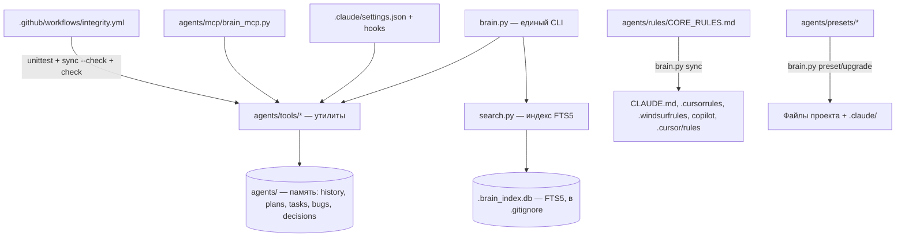

# 🗺️ Карта кодовой базы и граф зависимостей (CODEBASE_MAP.md)

**Проект:** Second Brain Template  
**Последнее обновление:** 2026-10-28  

Этот документ помогает любому входящему агенту за 30 секунд понять файловую структуру проекта, назначение каждого модуля и связи между ними.

---

## 🏗️ Архитектурный граф модулей (Component Graph)



---

## 📁 Структура каталогов и файлов проекта

```
Second Brain Template/
├── brain.py                        # ⚡ Переадресатор на agents/tools/brain.py (удобный вызов из корня)
├── agents/                         # 🧠 «Второй Мозг» проекта (долговременная память)
│   ├── STATUS.md                   # Дашборд состояния
│   ├── AGENT_GUIDE.md              # Главный навигатор
│   ├── rules/CORE_RULES.md         # 📜 Канон правил (единый источник для sync)
│   ├── templates/sync/*.tpl        # 📜 Шаблоны конфигов AI-инструментов
│   ├── tools/                      # 🛠️ Исполняемые инструменты (stdlib-only)
│   │   ├── brain.py                # Диспетчер CLI (status/plan/bug/sync/search/preset/upgrade/...)
│   │   ├── check_integrity.py      # Проверка целостности (10 секций)
│   │   ├── search.py               # 🔍 Полнотекстовый поиск памяти (SQLite FTS5)
│   │   ├── new_plan.py / end_session.py / dump_context.py / init_project.py
│   │   └── hooks/                  # Хуки Claude Code (gate, context, lint, session log)
│   ├── mcp/brain_mcp.py            # 🧩 MCP-сервер (6 инструментов, optional extra [mcp])
│   ├── presets/                    # 🧩 Пресеты стека (django-drf, aiogram-bot, fastapi, nextjs)
│   ├── plans|tasks|history|bugs_and_fixes|decisions|walkthroughs/  # Память
│   └── .preset_lock.json           # 🔒 sha256-lock для upgrade (создаётся при preset)
├── .claude/                        # Конфиг Claude Code: settings.json (хуки), agents/, skills/, commands/
├── .mcp.json                       # Пресеты подключения MCP-серверов (секреты только ${ENV})
├── tests/                          # 🧪 unittest: sync, hooks, mcp, presets, search
├── .github/workflows/integrity.yml # CI: compile + unittest + sync --check + integrity (Py 3.9/3.11/3.13)
├── pyproject.toml                  # 📦 Пакет second-brain-template, entry point `brain`
├── .env.example                    # Образец переменных окружения (без секретов!)
├── README.md                       # Документация проекта для людей
└── AGENTS.md                       # Входная точка для AI-агентов
```

---

## 📋 Таблица ответственности ключевых файлов

| Путь к файлу / модулю | Назначение и ответственность | Ключевые функции / классы | Что проверить при изменении |
|---|---|---|---|
| `agents/tools/brain.py` | Единый CLI-диспетчер | `main()`, `sync_tools()`, `apply_preset()`, `upgrade_tool()`, `_detect_project_root()` | `brain.py --help`, тесты всех подкоманд |
| `agents/rules/CORE_RULES.md` | 📜 Канон правил проекта | 11 правил (вкл. prompt-injection) | `python brain.py sync --check` — конфиги перегенерированы |
| `agents/tools/search.py` | 🔍 Поиск по памяти (FTS5) | `index_memory()`, `search_memory()`, `_fts_query()` | `tests/test_search.py`; индекс `.brain_index.db` в .gitignore |
| `agents/tools/check_integrity.py` | Целостность системы (10 секций) | `run_integrity_check(fix=)` | Запуск без ошибок; fail-soft без git |
| `agents/tools/hooks/*.py` | Исполняемые хуки Claude Code | `pre_tool_gate`, `inject_context`, `post_edit_lint`, `session_log` | `tests/test_hooks.py` (17 сценариев) |
| `agents/mcp/brain_mcp.py` | MCP-инструменты памяти | `get_status`, `create_plan`, `log_bug`, `search_memory`, `complete_task`, `end_session` | `tests/test_brain_mcp.py`; формат `.mcp.json` |
| `agents/presets/*/preset.json` | Манифесты пресетов стека | `files[]` (src → dst) | `tests/test_presets.py`; секретов в env.example нет |
| `agents/templates/sync/*.tpl` | Шаблоны 5 конфигов AI-инструментов | плейсхолдеры `{{...}}` | `brain.py sync` — дрейф отсутствует |
| `tests/` | Набор авто-тестов (94) | unittest (stdlib) | `python -m unittest discover -s tests` |
| `.github/workflows/integrity.yml` | CI-ворота | compile → unittest → sync --check → integrity | Матрица Python 3.9/3.11/3.13 зелёная |

> [!TIP]
> При добавлении или удалении файлов в проекте агент обязан поддерживать эту таблицу в актуальном состоянии! Детектор в `check_integrity.py` (секция 10) предупредит, если код менялся позже последнего обновления этого файла.
